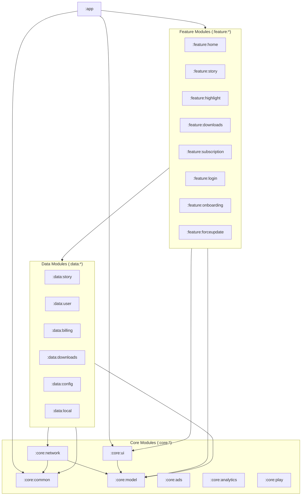

# Story Ghost

An open-source Android app to view Instagram stories anonymously, uncover hidden mentions, and
download media — built 100% with **Jetpack Compose**, **Material 3**, and modern multi-module
architecture.

[](https://github.com/vinit2510/Story-Ghost-Compose/releases/latest)
[](https://play.google.com/store/apps/details?id=in.vinit.storyghost)
[](https://play.google.com/store/apps/details?id=in.vinit.storyghost)
[](https://github.com/vinit2510/Story-Ghost-Compose/actions/workflows/ci.yml)
[](https://github.com/vinit2510/Story-Ghost-Compose/actions/workflows/release.yml)
[](https://android.com)
[](https://developer.android.com/jetpack/compose)
[](LICENSE)


<p align="center">
  <a href="https://play.google.com/store/apps/details?id=in.vinit.storyghost">
    
  </a>
</p>

---

## Why Story Ghost?

When you view stories on Instagram, your profile is added to the viewer list. Also, creators often
hide small mentions in stories that are impossible to tap, and downloading a story video usually
requires screen recording or sketchy third-party websites full of ads.

Story Ghost gives you a clean, private, and ad-minimal way to:

- Browse stories and highlights without leaving seen receipts.
- Detect hidden mentions and view tagged profiles instantly.
- Save photos and high-resolution videos directly to your device with one tap.

---

## Features

- **Anonymous Story Viewer**: Watch stories and highlights without appearing on the account's viewer
  list or sending seen receipts.
- **Hidden Mention Inspector**: Automatically scans story sticker data to identify hidden,
  transparent, or micro-sized mentions and reveals tagged accounts in an interactive popup.
- **Direct Media Downloads**: Save story photos and full-resolution MP4 videos directly to your
  device's public `Download/Story Ghost/` directory via Android's `DownloadManager` with real-time
  download notification progress.
- **ExoPlayer Video Playback**: Smooth, hardware-accelerated looping video playback powered by
  AndroidX Media3 (`ExoPlayer`), featuring lifecycle-aware auto-pausing and shimmer buffering
  loaders.
- **User Search & Highlights**: Search any public profile to inspect their active 24-hour stories
  and browse chronologically ordered highlight reels.
- **Flexible Sign-in**: Log in securely through an in-app WebView session or paste your session
  cookies (`sessionid` & `ds_user_id`) directly. Credentials stay strictly stored in local
  DataStore.
- **Offline Downloads Gallery**: View and manage all your saved media inside the app with quick
  options to preview, share, or delete downloaded files.
- **In-App Purchases (Premium)**: In-app billing powered by Google Play Billing Client (
  `:data:billing`, `:feature:subscription`) to unlock hidden mention inspection and remove all
  interstitial and open ads.
- **Seamless DataStore Migration**: Automated, backward-compatible migration from legacy
  `SharedPreferences` to Jetpack DataStore Preferences ensures zero session loss for upgrading
  users.
- **Multilingual Support**: Fully localized in 8 languages (English, Arabic, French, Indonesian,
  Italian, Portuguese, Spanish, and Turkish) — with community contributions for additional languages
  welcome!
- **Modern Material 3 UI**: Clean dark theme with edge-to-edge support, custom shimmer placeholders,
  and fluid Compose transitions.

---

## Architecture

Story Ghost is built using a modern **multi-module architecture** (22 modules) following Clean
Architecture principles and Unidirectional Data Flow (UDF).



### Module Structure

```text
├── app/                  # Application entry point, root Koin DI graph, Navigation 3 backstack
├── feature/              # Independent UI features (Compose + ViewModels)
│   ├── home/             # Story feed, following list, and profile search
│   ├── story/            # Fullscreen story viewer & ExoPlayer integration
│   ├── highlight/        # User highlight reels
│   ├── downloads/        # Saved media gallery
│   ├── login/            # WebView login & cookie parser dialogs
│   ├── onboarding/       # First-launch onboarding flow
│   ├── subscription/     # In-app purchase & Google Play Billing UI
│   └── forceupdate/      # Mandatory app update prompt screen
├── data/                 # Repositories and data sources
│   ├── story/            # Story & highlight API repository (modern Relay query)
│   ├── user/             # User profile & following list repository
│   ├── downloads/        # Decoupled DownloadManager repository
│   ├── billing/          # Google Play Billing Client integration
│   ├── config/           # Firebase Remote Config repository
│   └── local/            # Local data source abstraction
└── core/                 # Reusable low-level foundations
    ├── ui/               # Design system, theme, reusable components & VideoPlayer
    ├── model/            # Domain models (DTOs, entity models)
    ├── network/          # OkHttp, Retrofit, SafeApiCall & MockInterceptor
    ├── common/           # LocalStorage DataStore, Logger, TimeUtils
    ├── ads/              # AdMob & Meta Audience Network integration
    ├── analytics/        # Firebase Analytics abstraction
    └── play/             # In-App Review & In-App Update helpers
```

### Key Libraries & Tooling

- **UI:** Jetpack Compose, Material 3, Compose Foundation
- **Navigation:** AndroidX Navigation 3 (`androidx.navigation3`)
- **Dependency Injection:** [Koin](https://insert-koin.io/)
- **Media Playback:** AndroidX Media3 (ExoPlayer)
- **Image Loading:** Coil 3 (with OkHttp integration)
- **Networking:** Retrofit, OkHttp, Gson
- **In-App Billing:** Google Play Billing Client
- **Local Storage:** Jetpack DataStore Preferences
- **Analytics & Crashlytics:** Firebase Analytics & Crashlytics
- **Push Notifications:** OneSignal
- **Monetization:** Google AdMob & Meta Audience Network (FAN)
- **Testing:** JUnit, MockK, Cash App Turbine, Coroutines Test

---

## Getting Started

### Prerequisites

- **Android Studio:** Ladybug (2024.2+) or newer
- **JDK:** Java 21 (bundled with Android Studio / JBR)
- **Android SDK:** Compile SDK 37, Target SDK 37, Min SDK 26 (Android 8.0 Oreo)
- **NDK:** Configured in `app/build.gradle.kts` with native debug symbols for release builds

---

### End-to-End Setup Guide

#### 1. Clone the Repository

```bash
git clone https://github.com/vinit2510/Story-Ghost-Compose.git
cd Story-Ghost-Compose
```

#### 2. Environment Configuration (`.env`)

The build system uses a root `.env` file to manage API parameters, GraphQL query hashes, and ad unit
IDs.

A template file [`.env.example`](.env.example) is already included at the root of the project with
working defaults:

```bash
# Copy the example file to create your active .env
cp .env.example .env
```

> **Note:** If you skip this step, Gradle's build script (`readEnv.gradle`) will automatically copy
`.env.example` to `.env` on your first build so the project compiles immediately.

##### Explanation of Environment Variables

| Variable                            | Description                                                                                                                                                                                                             | Default in `.env.example`                |
|:------------------------------------|:------------------------------------------------------------------------------------------------------------------------------------------------------------------------------------------------------------------------|:-----------------------------------------|
| `IS_MOCK`                           | When `true`, `MockInterceptor` intercepts requests and serves local assets from `app/src/main/assets/mock_*.json`. Set to `false` for live Instagram network calls.                                                     | `true`                                   |
| `BASE_URL`                          | Base URL for Instagram's main web domain. Points to mock server in mock mode (`https://www.mock-server.com/`) or live Instagram web endpoints in production.                                                            | `https://www.mock-server.com/`           |
| `I_BASE_URL`                        | Secondary base URL for the mobile API domain. Used for user following lists and profile queries.                                                                                          | `https://i.mock-server.com/`             |
| `QH_USER_INFO`                      | Instagram GraphQL query hash / document identifier for fetching detailed user profile metadata.                                                                                                                         | `user_info`                              |
| `DOC_ID_STORY_AND_HIGHLIGHT`        | Instagram Relay Query document ID for the unified story and highlight media feed (`xdt_api__v1__feed__reels_media`).                                                                                                    | `story_and_highlight`                    |
| `QH_HIGHLIGHT_LIST`                 | Instagram GraphQL query hash for fetching the user's pinned highlight reel collections (`edge_highlight_reels`).                                                                                                        | `highlight_list`                         |
| `FIREBASE_BASE64`                   | Base64-encoded string of `google-services.json`. Automatically decoded by `readEnv.gradle` into `app/google-services.json` at build time so local builds compile without needing manual Firebase console configuration. | Included mock configuration              |
| `ONESIGNAL_APP_ID`                  | Application ID for OneSignal push notification service.                                                                                                                                                                 | `test_one_singal_id`                     |
| `ADMOB_APP_ID`                      | Google AdMob Application ID (pre-configured with Google's official test app ID).                                                                                                                                        | `ca-app-pub-3940256099942544~3347511713` |
| `FAN_REWARDED_INTERSTITIAL_AD_ID`   | Meta (Facebook) Audience Network placement ID for rewarded interstitial ads (pre-configured with official test ID).                                                                                                     | `VID_HD_9_16_39S_APP_INSTALL`            |
| `ADMOB_REWARDED_INTERSTITIAL_AD_ID` | Google AdMob Ad Unit ID for rewarded interstitial ads (pre-configured with official test ad unit ID).                                                                                                                   | `ca-app-pub-3940256099942544/5354046379` |
| `ADMOB_INTERSTITIAL_AD_ID`          | Google AdMob Ad Unit ID for standard interstitial ads shown after downloading stories for non-premium users.                                                                                                            | `ca-app-pub-3940256099942544/1033173712` |
| `ADMOB_APP_OPEN_AD_ID`              | Google AdMob Ad Unit ID for App Open ads displayed when launching or resuming the app.                                                                                                                                  | `ca-app-pub-3940256099942544/9257395921` |

#### 3. Build & Run

- **In Android Studio:**  
  Open the project directory, wait for Gradle sync to complete, and click **Run** (`Shift + F10`).
- **Via Command Line:**
  ```bash
  ./gradlew assembleDebug
  ```

---

### Mock Mode vs. Live Mode

- **Mock Mode (`IS_MOCK=true`):**  
  No Instagram account or live internet connection is needed. The app's `MockInterceptor` intercepts
  requests and serves realistic mock data (story feeds, user profiles, video reels, and highlights)
  directly from local JSON assets. All bundled mock media URLs are verified public links (Unsplash
  images and VideoJS MP4 videos) that render immediately. This is ideal for testing UI components,
  animations, and flows.
- **Live Mode (`IS_MOCK=false`):**  
  The app makes real network calls to Instagram. Sign in using the in-app WebView or paste your
  session cookies to browse live stories.

---

## Running Tests

To run the full unit test suite across all 22 modules:

```bash
./gradlew testDebugUnitTest
```

---

## Contributing

Contributions, bug reports, and translations are very welcome!

1. **Fork & Branch**: Create a feature branch off **`dev`**:
   ```bash
   git checkout -b feat/your-feature-name
   ```
2. **Local Development**: No API keys or credentials needed. Keep `IS_MOCK=true` in `.env` (default)
   to develop and test offline with mock data.
3. **Run Tests**: Verify that unit tests pass:
   ```bash
   ./gradlew testDebugUnitTest
   ```
4. **Submit PR**: Open a Pull Request targeting the **`dev`** branch
   using [Conventional Commits](https://www.conventionalcommits.org/).

### Localization

To add or update translations, edit the string resources in
`core/ui/src/main/res/values-<locale>/strings.xml` and submit a PR titled
`feat(i18n): add <Language> translations`.

---

### Releases & Direct APK Downloads

In addition
to [Google Play Store](https://play.google.com/store/apps/details?id=in.vinit.storyghost) releases,
production builds are automatically published on GitHub:

- When a new release tag (e.g., `vX.Y.Z`) is pushed to `master` or triggered via workflow dispatch,
  GitHub Actions automatically builds, signs, and publishes a new **GitHub Release** with both the
  signed production AAB and universal APK.
- Users and testers can download and install updates directly from
  the [GitHub Releases page](https://github.com/vinit2510/Story-Ghost-Compose/releases) to get the
  latest features without waiting for app store review delays.

---

## License

```text
Copyright 2026 Vinit Hingu

Licensed under the Apache License, Version 2.0 (the "License");
you may not use this file except in compliance with the License.
You may obtain a copy of the License at

    http://www.apache.org/licenses/LICENSE-2.0

Unless required by applicable law or agreed to in writing, software
distributed under the License is distributed on an "AS IS" BASIS,
WITHOUT WARRANTIES OR CONDITIONS OF ANY KIND, either express or implied.
See the License for the specific language governing permissions and
limitations under the License.
```

---

## Disclaimer

This project is open-source and intended for educational and personal use only. It is not affiliated
with, authorized, maintained, or endorsed by Instagram or Meta Platforms, Inc. Use responsibly and
in accordance with applicable laws.
