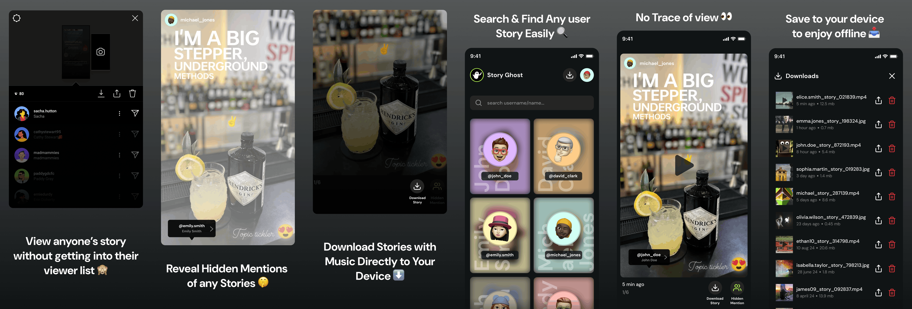
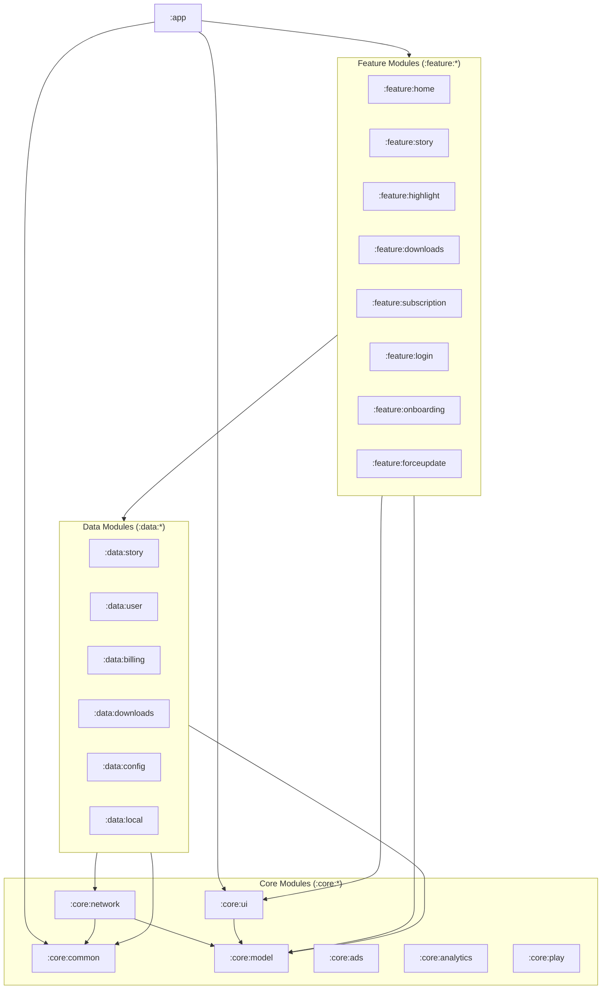
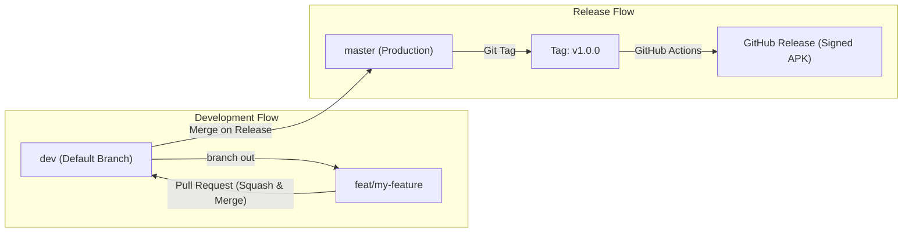

# Story Ghost

An open-source Android app to view Instagram stories anonymously, uncover hidden mentions, and
download media — built 100% with **Jetpack Compose**, **Material 3**, and modern multi-module
architecture.

[](https://android.com)
[](https://kotlinlang.org)
[](https://developer.android.com/jetpack/compose)
[](LICENSE)


---

## Why Story Ghost?

When you view stories on Instagram, your profile is added to the viewer list. Also, creators often
hide small mentions in stories that are impossible to tap, and downloading a story video usually
requires screen recording or sketchy third-party websites full of ads.

Story Ghost gives you a clean, private, and ad-minimal way to:

- Browse stories and highlights without leaving seen receipts.
- Detect hidden mentions and view tagged profiles instantly.
- Save photos and high-resolution videos directly to your device with one tap.

---

## Features

- **Anonymous Story Viewer**: Watch stories and highlights without appearing on the account's viewer
  list.
- **Hidden Mention Inspector**: Automatically identifies hidden, transparent, or tiny mentions
  placed on stories and presents them in an easy-to-tap card.
- **Direct Media Downloads**: Save story photos and full-resolution MP4 videos directly to your
  gallery via Android's MediaStore.
- **ExoPlayer Video Playback**: Smooth, hardware-accelerated playback powered by AndroidX Media3
  with progress tracking and mute/unmute toggle.
- **User Search & Highlights**: Search any username to view their active 24-hour stories and pinned
  highlight collections.
- **Flexible Sign-in**: Log in through an in-app WebView session or paste your session cookies
  directly. Your credentials stay strictly on your device.
- **Offline Downloads Gallery**: View and manage all your saved media inside the app with quick
  options to share or delete.
- **Multilingual Support**: Fully localized in English, Spanish, Portuguese, Italian, Indonesian,
  and Arabic — with community contributions for additional languages welcome!
- **Material 3 UI**: Clean dark theme with edge-to-edge support and smooth Compose animations.

---

## Architecture

Story Ghost is built using a modern **multi-module architecture** following Clean Architecture
principles and Unidirectional Data Flow (UDF).



### Module Structure

```text
├── app/                  # Application class, root DI graph, Navigation 3 backstack
├── feature/              # Independent UI features (Compose + ViewModels)
│   ├── home/             # Story feed, search, and highlight mode
│   ├── story/            # Fullscreen story viewer & ExoPlayer integration
│   ├── highlight/        # User highlight reels
│   ├── downloads/        # Saved media gallery
│   ├── login/            # WebView login & cookie parser
│   ├── onboarding/       # First-launch introduction
│   └── subscription/     # In-app purchase & billing options
├── data/                 # Repositories and data sources
│   ├── story/            # Story & highlight API integration
│   ├── user/             # User search & profile fetching
│   ├── downloads/        # MediaStore & DownloadManager operations
│   ├── billing/          # Google Play Billing Client integration
│   ├── config/           # Firebase Remote Config repository
│   └── local/            # Local data source abstraction
└── core/                 # Shared low-level modules
    ├── ui/               # Reusable Composables, theme, and VideoPlayer
    ├── model/            # Plain Kotlin domain data models
    ├── network/          # OkHttp, Retrofit, interceptors, and mock handlers
    ├── common/           # DataStore LocalStorage, file helpers, logger
    ├── ads/              # AdMob & Meta Audience Network integration
    ├── analytics/        # Firebase Analytics abstraction
    └── play/             # In-App Review & In-App Update helpers
```

### Key Libraries

- **UI:** Jetpack Compose, Material 3, Compose Foundation
- **Navigation:** AndroidX Navigation 3 (`androidx.navigation3`)
- **Dependency Injection:** [Koin](https://insert-koin.io/)
- **Media Playback:** AndroidX Media3 (ExoPlayer)
- **Image Loading:** Coil 3 (with video thumbnail decoding)
- **Networking:** Retrofit 2, OkHttp 3, Gson
- **Local Storage:** Jetpack DataStore Preferences
- **Testing:** JUnit 4, MockK, Cash App Turbine

---

## Getting Started

### Prerequisites

- **Android Studio:** Ladybug (2024.2+) or newer
- **JDK:** Java 21 (bundled with Android Studio)
- **Android SDK:** Compile SDK 35/37, Min SDK 26 (Android 8.0 Oreo)

---

### End-to-End Setup Guide

#### 1. Clone the Repository

```bash
git clone https://github.com/vinit2510/Story-Ghost-Compose.git
cd Story-Ghost-Compose
```

#### 2. Environment Configuration (`.env`)

The build system uses a root `.env` file to manage API parameters, GraphQL query hashes, and ad unit
IDs.

A template file [`.env.example`](.env.example) is already included at the root of the project with
working defaults:

```bash
# Copy the example file to create your active .env
cp .env.example .env
```

> **Note:** If you skip this step, Gradle's build script (`readEnv.gradle`) will automatically copy
`.env.example` to `.env` on your first build so the project compiles immediately.

##### Key Environment Variables:

| Variable            | Description                                                                                                                      | Default in `.env.example`      |
|:--------------------|:---------------------------------------------------------------------------------------------------------------------------------|:-------------------------------|
| `IS_MOCK`           | When `true`, uses bundled offline JSON fixtures. Set to `false` for live Instagram network calls.                                | `true`                         |
| `BASE_URL`          | Base endpoint URL for network requests.                                                                                          | `https://www.mock-server.com/` |
| `FIREBASE_BASE64`   | Base64-encoded `google-services.json`. The build script automatically decodes this into `app/google-services.json` during build. | Included mock configuration    |
| `QH_*`              | Instagram GraphQL query hashes for stories, highlights, and profile endpoints.                                                   | Pre-configured                 |
| `ADMOB_*` / `FAN_*` | Ad unit IDs. Populated with official Google test ad unit IDs.                                                                    | Test ad IDs                    |

#### 3. Build & Run

- **In Android Studio:**  
  Open the project directory, wait for Gradle sync to complete, and click **Run** (`Shift + F10`).
- **Via Command Line:**
  ```bash
  ./gradlew assembleDebug
  ```

---

### Mock Mode vs. Live Mode

- **Mock Mode (`IS_MOCK=true`):**  
  No Instagram account or live internet connection is needed. The app's `MockInterceptor` intercepts
  requests and serves realistic mock data (story feeds, user profiles, video reels, and highlights)
  directly from local JSON assets. This is ideal for testing UI components, animations, and flows.
- **Live Mode (`IS_MOCK=false`):**  
  The app makes real network calls to Instagram. Sign in using the in-app WebView or paste your
  session cookies to browse live stories.

---

## Running Tests

To run the full unit test suite across all modules:

```bash
./gradlew testDebugUnitTest
```

---

## Contributing

Contributions, bug reports, and translations are very welcome! Whether you are fixing a bug, adding
a new Compose component, optimizing architecture, or translating into your native language, your
help makes Story Ghost better for everyone.

### Branching Model

To keep our commit history clean and prevent broken release builds, we use a two-branch workflow:

- **`dev` (Default branch)**: All active development happens here. All community Pull Requests must
  target `dev`.
- **`master` (Production branch)**: Production-ready code only. Changes are merged from `dev` to
  `master` only when cutting an official release.



> [!IMPORTANT]
> **Always target `dev`** when submitting a Pull Request. Pull Requests opened against `master` will
> be requested to re-target `dev`.

---

### Local Development (Zero Credentials Needed)

You do **not** need an active Instagram account or developer credentials to contribute to Story
Ghost:

- Set `IS_MOCK=true` in your root `.env` file (the default for local development).
- The built-in `MockInterceptor` intercepts requests and serves realistic mock JSON responses for
  story feeds, user profiles, video reels, and highlights.
- You can freely build, run, and test UI components, animations, and feature logic completely
  offline.

---

### Pull Request Workflow

1. **Fork the repository** on GitHub:
   [https://github.com/vinit2510/Story-Ghost-Compose](https://github.com/vinit2510/Story-Ghost-Compose)
2. **Clone your fork** and branch off `dev`:
   ```bash
   git checkout dev
   git pull origin dev
   git checkout -b feat/your-feature-name
   ```
3. **Make your changes** following our code style and architecture patterns.
4. **Follow Conventional Commits** for clear and readable commit messages:
    - `feat: add story duration badge`
    - `fix: resolve crash on null thumbnail`
    - `refactor: extract video controls composable`
    - `docs: update setup guide in README`
    - `test: add unit tests for StoryViewModel`
5. **Run tests** and verify everything builds cleanly:
   ```bash
   ./gradlew testDebugUnitTest
   ```
6. **Push to your fork** and open a Pull Request targeting the **`dev`** branch.
7. PRs will be reviewed and merged into `dev` using **Squash and Merge** to maintain a clean linear
   commit history.

---

### Localization & Translations

Help bring Story Ghost to more users worldwide! All strings are centralized in the `:core:ui`
module:

- Source strings: `core/ui/src/main/res/values/strings.xml`
- Locale strings: `core/ui/src/main/res/values-<locale>/strings.xml` (e.g. `values-es`, `values-ar`,
  `values-pt-rBR`)

To add a new language:

1. Create a new directory `core/ui/src/main/res/values-<language-code>/`
2. Copy `strings.xml` into it and translate the string values.
3. Submit a PR titled `feat(i18n): add <Language> translations`.

---

### Releases & Direct APK Downloads

In addition to Google Play Store releases, production builds are automatically published on GitHub:

- When a new release tag (e.g., `v1.0.0`) is pushed to `master`, GitHub Actions automatically
  builds, signs, and publishes a new **GitHub Release** with the production APK.
- Users and testers can download and install updates directly from
  the [GitHub Releases page](https://github.com/vinit2510/Story-Ghost-Compose/releases) to get the
  latest features without waiting for app store review delays.

---

## License

```text
Copyright 2026 Vinit Hingu

Licensed under the Apache License, Version 2.0 (the "License");
you may not use this file except in compliance with the License.
You may obtain a copy of the License at

    http://www.apache.org/licenses/LICENSE-2.0

Unless required by applicable law or agreed to in writing, software
distributed under the License is distributed on an "AS IS" BASIS,
WITHOUT WARRANTIES OR CONDITIONS OF ANY KIND, either express or implied.
See the License for the specific language governing permissions and
limitations under the License.
```

---

## Disclaimer

This project is open-source and intended for educational and personal use only. It is not affiliated
with, authorized, maintained, or endorsed by Instagram or Meta Platforms, Inc. Use responsibly and
in accordance with applicable laws.
